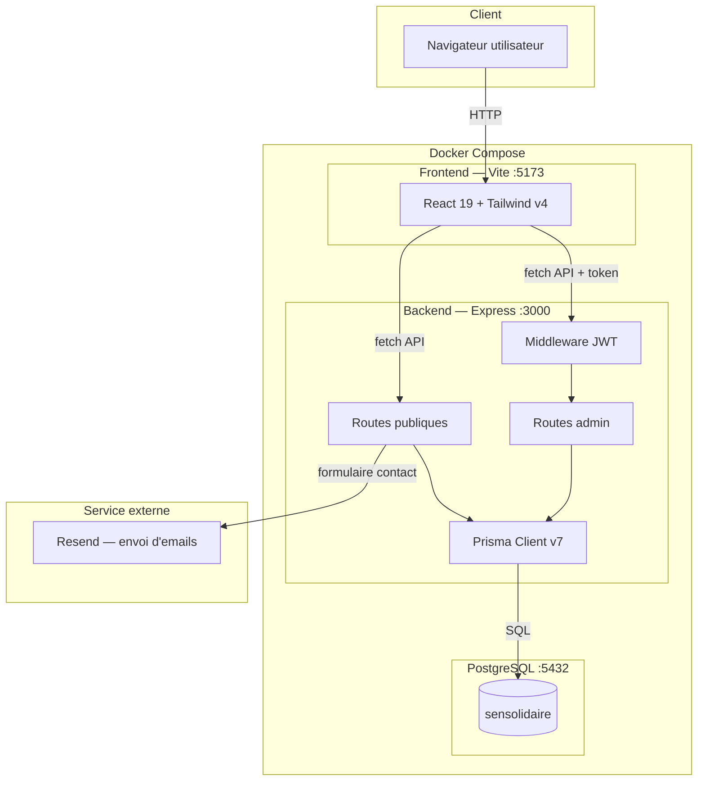
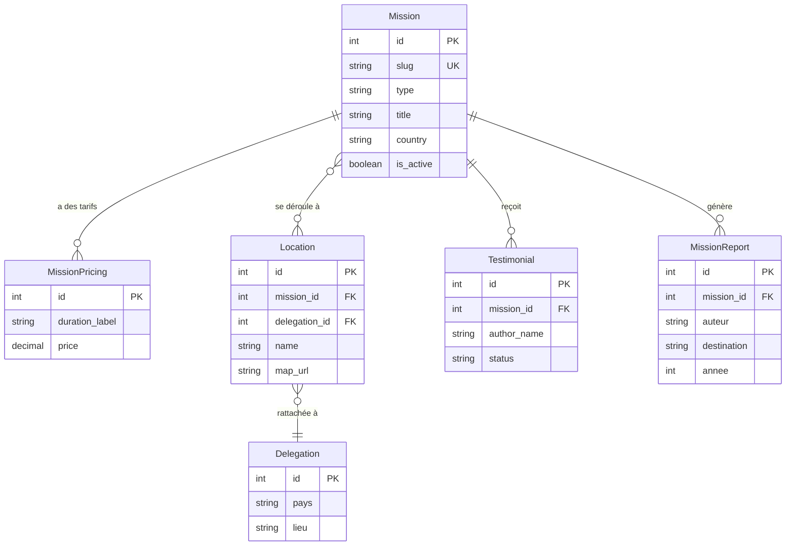
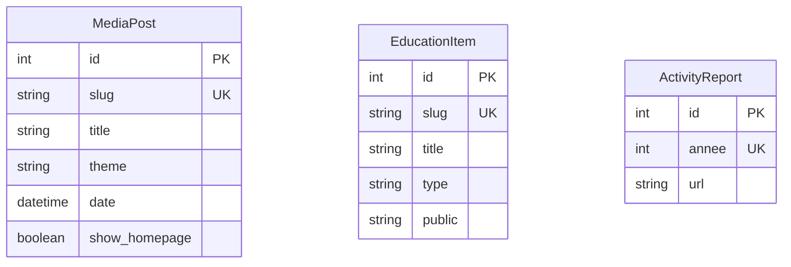
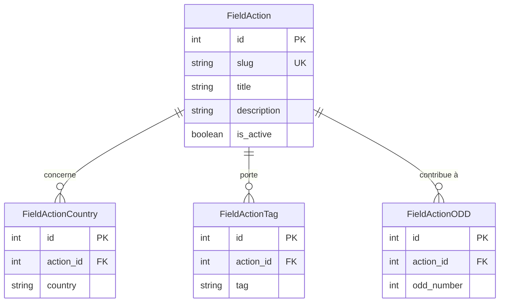
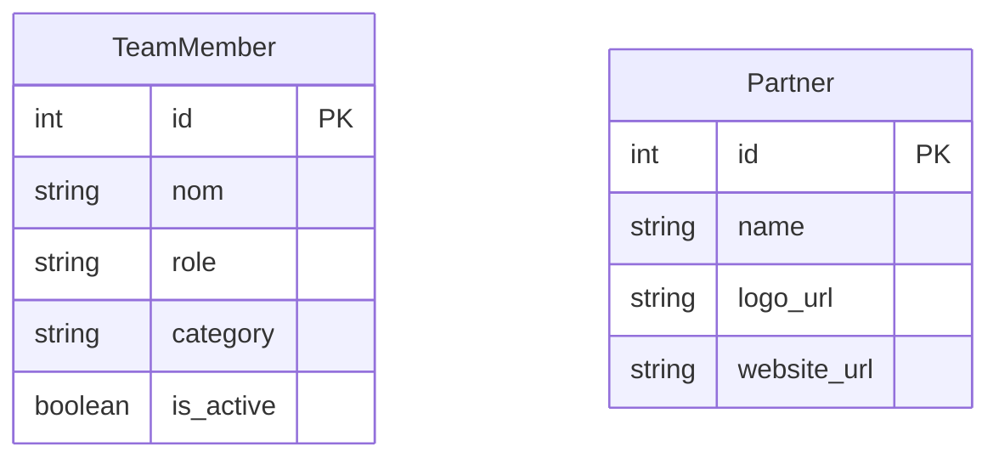
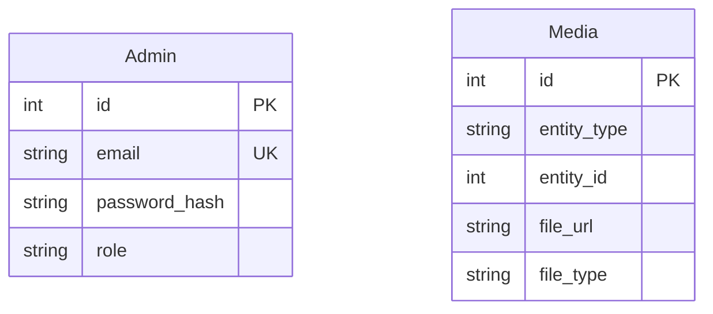

# Sens Solidaires

Refonte complète du site web de **Sens Solidaires**, association humanitaire et environnementale, réalisée dans le cadre d'un projet de fin de formation à Holberton School (Thonon-les-Bains). Le projet couvre le site vitrine public et un dashboard d'administration permettant à l'association de gérer ses contenus en autonomie.

## Sommaire

- [Stack technique](#stack-technique)
- [Architecture](#architecture)
- [Base de données](#base-de-données)
- [Fonctionnalités principales](#fonctionnalités-principales)
- [Installation](#installation)
- [Structure du repo](#structure-du-repo)
- [Tests](#tests)
- [Équipe & rôles](#équipe--rôles)
- [Liens](#liens)

## Stack technique

| Côté | Technologies |
|---|---|
| **Frontend** | React 19 · Vite · Tailwind CSS v4 · React Router v7 · Swiper |
| **Backend** | Node.js · Express · Prisma v7 · PostgreSQL |
| **Authentification** | JWT (access + refresh token) · bcrypt |
| **Emails** | Resend (formulaire de contact) |
| **Infrastructure** | Docker Compose |
| **Tests** | Jest + Supertest (API) · Vitest + React Testing Library (front) · Postman (runbook manuel) |

## Architecture



Le frontend (React) et le backend (Express) sont deux applications indépendantes, chacune dans son propre conteneur Docker, communiquant exclusivement via une **API REST** en JSON.

**Frontend** : une seule application React contient à la fois les pages publiques du site vitrine et le dashboard d'administration. Les routes admin (`/admin/...`) sont protégées côté client et ne s'affichent que si un token JWT valide est présent.

**Backend** : Express expose les routes API, découpées en deux catégories :
- routes **publiques** (missions, témoignages, contact...) accessibles sans authentification
- routes **admin** (CRUD missions, modération...) protégées par un middleware qui vérifie le JWT

**Authentification** : un système à deux tokens — un *access token* de courte durée (transmis dans le header) et un *refresh token* de longue durée (stocké en cookie HTTP-only, inaccessible en JavaScript) pour limiter les risques en cas de vol de token.

**Base de données** : Prisma sert de couche d'accès entre le backend et PostgreSQL — il génère les requêtes SQL et garantit la cohérence du schéma (migrations versionnées).

**Service externe** : Resend gère l'envoi d'emails depuis le formulaire de contact public — aucune donnée sensible n'y transite (pas d'authentification requise).

## Base de données

### Domaine 1 — Missions



**Note d'architecture — FieldAction** : le lien entre une mission et les actions terrain associées (`FieldAction`) se fait par correspondance de pays (`Mission.country` / `FieldActionCountry`), sans relation FK en base. Ce choix est adapté au MVP, où seul le type "Volontariat individuel" est entièrement piloté par la BDD — les types Service Civique, Groupe jeunes et Congé solidaire restent des sections informatives partiellement codées en dur.

**Évolution prévue (V2)** : une fois le CRUD dashboard des actions terrain construit, la cliente pourra associer manuellement une action à une ou plusieurs missions d'un même pays, indépendamment de leur type (ex : un projet de jardin potager commencé par un groupe jeunes au Sénégal, puis poursuivi par des volontaires individuels dans ce même pays). Cela nécessitera une relation many-to-many explicite (`MissionFieldAction`), la card d'impact pouvant alors s'afficher sur plusieurs pages mission simultanément — toutes rattachées au même pays.

**Redondance assumée — MissionReport** : les champs `destination` et `type` de `MissionReport` deviennent redondants avec `mission.country` / `mission.type` lorsque `mission_id` est renseigné. Ce choix est volontaire : `mission_id` est optionnel car un rapport peut exister sans mission liée en base (ex : retour d'expérience déposé par un enseignant sur un projet non fiché comme mission officielle). Les champs texte servent alors de repli pour ne pas perdre l'information dans ce cas.

### Domaine 2 — Contenu éditorial



**Note d'architecture** : ces 3 tables sont indépendantes — aucune relation FK entre elles ni vers `Mission`. Ce sont des contenus éditoriaux autonomes (articles, ateliers pédagogiques, rapports d'activité annuels).

`MediaPost` et `EducationItem` peuvent avoir des médias attachés via la table polymorphique `Media` (voir Domaine 5), mais ce lien ne passe pas par une FK classique et n'est donc pas représenté ici.

**Évolution prévue (V2) — MediaPost** : la cliente pourra publier un article directement rattaché à une mission spécifique (ex : un retour d'expérience terrain publié en actualité, lié à la mission Kenya). Cela nécessitera l'ajout d'une FK optionnelle `mission_id` sur `MediaPost`, suivant le même pattern que `Testimonial` et `MissionReport` — un article pouvant aussi rester indépendant de toute mission (actualités générales de l'association).

### Domaine 3 — Impact terrain



**Note d'architecture** : `FieldActionCountry` remplace un ancien champ `country: string` fragile — une action peut désormais concerner plusieurs pays (ex : projet transfrontalier Sénégal/France). `FieldActionODD` relie une action à un ou plusieurs des 17 Objectifs de Développement Durable de l'ONU.

Aucune relation FK vers `Mission` dans ce domaine — voir la note d'architecture du **Domaine 1 — Missions** pour le lien actuel (par correspondance de pays) et son évolution prévue en V2 (relation many-to-many `MissionFieldAction`).

### Domaine 4 — Communauté



**Note d'architecture** : `TeamMember` et `Partner` sont des tables indépendantes, sans relation FK entre elles ni vers `Mission`/`Delegation`. `TeamMember.category` distingue les membres par rôle dans l'association (direction, bureau, conseil d'administration, autres) — à ne pas confondre avec `Delegation`, qui représente les équipes locales rattachées à un pays et à des missions à l'étranger (voir Domaine 1).

### Domaine 5 — Admin + Médias



**Note d'architecture — Media (polymorphique)** : `Media` ne possède aucune FK Prisma classique. Le champ `entity_type` (ex: `"mission"`, `"education_item"`) combiné à `entity_id` permet de rattacher un fichier à n'importe quelle entité du projet, sans dupliquer la table Media par domaine. Contrepartie assumée : l'intégrité référentielle n'est pas garantie par PostgreSQL/Prisma ici (pas de contrainte FK, pas de cascade automatique) — elle est gérée manuellement côté service (`mediaService.js`).

**Note d'architecture — Admin** : table simple, sans relation. Un seul rôle existe actuellement (`"admin"` par défaut) ; le champ `role` anticipe une éventuelle gestion multi-rôles future (ex: modérateur vs admin complet).

## Fonctionnalités principales

### Site public

- Page d'accueil connectée à l'API (missions, témoignages, actions terrain, partenaires)
- Navbar dynamique — dropdown "Nos missions" connecté à l'API (destinations + "S'engager autrement")
- Page missions (`/missions`) — 4 sections par type, filtres, navigation par ancres
- Page détail mission (`/missions/:slug`) — programme (JSON), tarifs, lieux, témoignages, galerie BDD, infos pratiques en puces
- Page détail lieu (`/lieux/:slug`) — contacts délégation, carte Google Maps, galerie
- Page témoignages — soumission par les visiteurs (RGPD) + affichage des témoignages validés
- Page contact — formulaire + envoi d'email (Resend)
- Page Éducation & sensibilisation — ODD, ateliers, Éco-École, correspondances
- Pages institutionnelles : à propos, équipe, rapports d'activité, soutenir
- Pages légales : mentions, confidentialité, cookies
- Responsive mobile-first (375 / 768 / 1024 / 1440)

> **Interface en français uniquement pour la V1.** La version bilingue français / anglais figurait au périmètre initial : elle est repoussée après la V1, la cliente n'ayant pas encore arbitré entre une traduction rédigée en interne et une traduction automatique. La structure de la base anticipe les deux scénarios.

### Dashboard administrateur

- Authentification sécurisée (JWT access + refresh token)
- CRUD missions complet — formulaire en 9 blocs : informations, visuel, contenu détaillé, programme, tarifs, logistique, comment partir, infos pratiques, galerie photos
- Gestion des tarifs par mission (ajout/modification/suppression dynamique)
- Gestion de la galerie et du PDF par mission
- Modération des témoignages (validation / refus, règle RGPD sur refus → retrait page d'accueil)

## Installation

### Prérequis

- Docker et Docker Compose installés
- Git

### 1. Cloner le repo

```bash
git clone https://github.com/GwenP88/sens-solidaire.git
cd sens-solidaire
```

### 2. Variables d'environnement

Deux fichiers `.env` sont nécessaires. Copier les fichiers d'exemple puis renseigner les valeurs :

```bash
cp .env.example .env
cp backend/.env.example backend/.env
```

- `.env` (racine) : lu par Docker Compose. Mots de passe PostgreSQL (`POSTGRES_PASSWORD`, `DB_APP_PASSWORD`, `DB_OWNER_PASSWORD`) et secrets JWT.
- `backend/.env` : configuration de l'API (Resend, mot de passe du compte admin, e-mail de contact).

Les secrets JWT se génèrent avec `openssl rand -base64 48` (deux valeurs différentes).

### 3. Lancer les conteneurs

```bash
docker compose up -d --build
```

### 4. Créer les comptes PostgreSQL

L'application utilise deux comptes distincts (principe du moindre privilège) :
`sensolidaire_owner` pour les migrations, `sensolidaire_app` pour l'API.
Les mots de passe doivent être identiques à `DB_OWNER_PASSWORD` et `DB_APP_PASSWORD` du `.env` racine.

```bash
docker compose exec -T postgres psql -U postgres -d sensolidaire \
  -v owner_password='MOT_DE_PASSE_OWNER' -v app_password='MOT_DE_PASSE_APP' \
  < backend/prisma/roles.sql
```

À exécuter une seule fois, à la première installation.

### 5. Préparer la base de données

```bash
docker compose exec backend npx prisma migrate deploy
docker compose exec backend npx prisma generate
docker compose exec backend node prisma/seed.js
```

### 6. Accéder à l'application

| Service | URL |
|---|---|
| Frontend | http://localhost:5173 |
| Backend API | http://localhost:3001/api/health |
| Prisma Studio | http://localhost:5555 |

L'API écoute sur le port 3000 dans son conteneur, exposé sur le port 3001 de la machine hôte.

### Connexion au dashboard admin

Un compte administrateur est créé automatiquement par le seed :

- **Email** : `admin@sensolidaire.org`
- **Mot de passe** : celui défini dans `ADMIN_PASSWORD` (voir `backend/.env`)

## Structure du repo

```
sens-solidaire/
├── frontend/                  # Application React (Vite)
│   ├── src/
│   │   ├── components/
│   │   │   ├── layout/        # Navbar, Footer, Layout
│   │   │   ├── ui/            # Composants réutilisables (Button, Badge, Carousel...)
│   │   │   ├── admin/         # Composants spécifiques au dashboard
│   │   │   └── testimonials/  # Composants témoignages
│   │   ├── pages/             # Une page par route
│   │   │   └── admin/         # Pages du dashboard
│   │   ├── services/api/      # Appels HTTP : un fichier par ressource + client.js (authFetch) + index.js
│   │   └── utils/             # Constantes partagées (filtres, icônes, footerCta...)
│   ├── tests/                 # Vitest + RTL : unit/, components/, pages/
│   └── public/images/         # Images statiques, classées par contexte métier
│
├── backend/                   # API Node.js / Express
│   ├── src/
│   │   ├── routes/            # Définition des endpoints
│   │   ├── controllers/       # Validation + formatage réponse
│   │   ├── services/          # Logique métier + accès Prisma
│   │   ├── middlewares/       # authMiddleware (JWT), uploadMiddleware (Multer)
│   │   ├── utils/             # Fonctions pures (validation, slugify, youtube, prismaErrors...)
│   │   └── config/            # Connexion DB
│   ├── prisma/
│   │   ├── schema.prisma      # Schéma de base de données
│   │   ├── migrations/        # Historique des migrations
│   │   └── seed.js            # Données de test
│   └── tests/                 # Jest : unit/ (sans base) + intégration Supertest (helpers/adminCrud.js)
│
├── docs/                      # Documentation du projet — voir docs/README.md
│   ├── README.md              # Sommaire de la documentation
│   ├── JDB.md                 # Journal de bord quotidien
│   ├── planning.md            # Sprint planning
│   ├── veille.md              # Journal de veille sécurité
│   ├── modif-en-cours-de-dev.md  # Écarts assumés par rapport aux guides initiaux
│   ├── guide-de-style.md      # Design system
│   └── test_postman_back.md   # Runbook de tests API
│
└── docker-compose.yml         # Orchestration des 3 services
```

## Tests

Environ **400 tests automatisés** : 279 côté backend (90 unitaires + 189 d'intégration), 122 côté frontend.

| Commande | Ce qu'elle lance | Base de données |
|---|---|---|
| `docker exec sensolidaire_backend npm run test:unit` | Tests unitaires backend (`tests/unit/`) — quelques secondes | Non |
| `docker exec sensolidaire_backend npm run test:integration` | Tests d'intégration backend (routes HTTP réelles via Supertest) | **Oui** |
| `docker exec sensolidaire_backend npm test` | Tous les tests backend | **Oui** |
| `docker exec sensolidaire_frontend npm run test:run` | Tous les tests frontend, une seule fois | Non |
| `cd frontend && npm run test:run` (sur le poste) | Idem + test de cohérence front / back (voir plus bas) | Non |

> **Avant de lancer les tests d'intégration** : faire une sauvegarde de la base ([`docs/sauvegarde-restauration.md`](./docs/sauvegarde-restauration.md)).
> Ils tournent sur la vraie base du conteneur, mais ne créent, modifient et suppriment **que** des enregistrements marqués `jest-test`
> (nettoyés avant et après chaque fichier). Ils se connectent avec le compte admin : une session ouverte dans le dashboard devra se reconnecter.
> Aucun test n'envoie de vrai e-mail (le formulaire de contact n'est testé que sur ses refus).

### Backend — tests unitaires (`backend/tests/unit/`, Jest)

Fonctions pures et middleware, sans serveur ni base :

| Fichier | Ce qui est vérifié |
|---|---|
| `validation.test.js` | `isFilled`, `isValidYear` (bornes 2000 → année prochaine), `isValidSlug` |
| `slugify.test.js` | accents, ponctuation, longueur max 80, valeur de secours ; toute adresse générée passe `isValidSlug` |
| `shortDescription.test.js` | repère `---` (retiré du texte complet), coupe à la dernière phrase, jamais en plein mot |
| `odds.test.js` | les 17 ODD ont une catégorie, dédoublonnage des thèmes |
| `countries.test.js` | code drapeau (Sumatra → Indonésie), nom inconnu → `null`, tri à la française |
| `youtube.test.js` | formats de liens acceptés (watch, youtu.be, shorts, embed), liens piégés refusés |
| `prismaErrors.test.js` | traduction des erreurs Prisma : `P2025` → 404, `P2002` → 409 |
| `jwt.test.js` | access token 15 min / refresh token 7 j, secrets distincts, jeton expiré ou falsifié refusé |
| `authMiddleware.test.js` | 401 sans jeton / format invalide / jeton invalide, 403 si rôle différent d'admin, `req.user` renseigné |

### Backend — tests d'intégration (`backend/tests/`, Jest + Supertest)

**CRUD du dashboard** — un scénario commun ([`tests/helpers/adminCrud.js`](./backend/tests/helpers/adminCrud.js)) joué sur 7 ressources
(`MediaPosts`, `FieldActions`, `Locations`, `TeamMembers`, `Partners`, `ActivityReports`, `MissionReports`) :
401 sans jeton · 400 champ obligatoire manquant · 201 création · lecture par id · 404 sur id inexistant (lecture, modification, pause, suppression) ·
modification · visible sur le site public si actif · invisible une fois en pause · réactivation · suppression définitive.
Cas propres en plus : page publique d'un contenu en pause → 404 (médias, actions, lieux), vidéos YouTube d'un article,
adresse d'action déjà prise → 409, deux rapports d'activité la même année → 409.

| Fichier | Ce qui est vérifié |
|---|---|
| `Auth.integration.test.js` | login (400 / 401 / 200), même message pour un e-mail inconnu et un mauvais mot de passe, cookie refresh `HttpOnly` + `SameSite=Strict`, rotation du refresh token (l'ancien est refusé), déconnexion |
| `Public.integration.test.js` | routes publiques : formats, filtres missions (type / pays / longueur), aucun contenu en pause ni témoignage non approuvé exposé, pages détail inexistantes → 404 |
| `Security.integration.test.js` | en-têtes Helmet, CORS (origine autorisée / inconnue → 403), toutes les routes admin fermées sans jeton, jeton falsifié |
| `Contact.integration.test.js` | validation serveur du formulaire de contact (champs manquants, trop longs, e-mail invalide) |
| `Missions.admin.test.js` | CRUD missions : création, 400 / 401 / 409, modification partielle, soft delete |
| `Testimonials.admin.test.js` | modération : approbation, JWT altéré, protection contre le mass assignment |
| `Upload.security.test.js` | non-régression de l'audit : path traversal, type refusé en 400, upload admin sans jeton |

### Frontend — Vitest + React Testing Library (`frontend/tests/`)

| Dossier | Ce qui est vérifié |
|---|---|
| `unit/` | validation, aperçu du résumé, ODD (chaque catégorie correspond à un filtre de Notre Impact), filtres pays, messages d'erreur du dashboard (vouvoiement, pas de jargon) |
| `unit/duplicatedRules.test.js` | les règles **dupliquées volontairement** entre front et back (slug, année, ODD, YouTube, résumé) donnent les mêmes résultats. Exécuté sur le poste uniquement : le conteneur frontend ne voit pas `backend/` (exclusion automatique dans `vite.config.js`) |
| `components/` | `Modal`, `ConfirmModal`, `ErrorModal`, `DashboardTable`, `FormElements`, `FilterSelect`, `YouTubeLinksField`, navigation du dashboard (barre mobile, avertissement « prévue pour un ordinateur », `ProtectedRoute`) |
| `pages/` | avec API simulée : `Testimonials` (filtre destination des rapports), `Impact` (pays dérivés des actions), `LocationsPage` (modale d'erreur au lieu d'un `alert`), `MediaPostFormPage` (validation et envoi des vidéos YouTube) |
| racine | `LignesToPuces`, `Button`, `TestimonialForm` (consentement RGPD, erreur d'envoi), `LoginAdmin`, `filters`, `youtube` |

### Tests manuels (Postman)

Un runbook complet est disponible dans [`docs/test_postman_back.md`](./docs/test_postman_back.md), couvrant le démarrage de l'environnement, la préparation de la base de données et les scénarios de test par endpoint.

### Stratégie de test adoptée

| Type | Usage |
|---|---|
| **Jest — unitaires (backend)** | Fonctions pures et middleware, sans base : rapides, lancés à chaque modification |
| **Jest + Supertest (backend)** | Routes HTTP réelles sur la base Docker : CRUD, authentification, sécurité, visibilité publique |
| **Vitest + RTL (frontend)** | Fonctions pures, composants, règles métier UI, appels API mockés |
| **Postman (manuel)** | Exploration et validation des nouveaux endpoints avant automatisation |

### Sécurité des dépendances

Audit via `npm audit` (frontend et backend) avant chaque merge sur `dev`.
Dernier audit backend : **22/09/2026** — 16 vulnérabilités détectées, 12 corrigées par `npm audit fix`. Les 4 restantes concernent des dépendances indirectes de Prisma : leur correction imposerait un changement de version majeur, étudié séparément. Résultats consignés dans [`docs/veille.md`](./docs/veille.md).

## Équipe & rôles

Projet réalisé en binôme dans le cadre de la formation Holberton School (Thonon-les-Bains).

| Rôle | Personne | Périmètre |
|---|---|---|
| **Développement Frontend** | Gwen Pichot (principal) · Alison Amblard (dashboard) | React, Tailwind, design system, intégration API |
| **Développement Backend** | Alison Amblard (principal) · Gwen Pichot (certains items) | Node.js, Express, Prisma, base de données |
| **Conception UX / UI** | Gwen Pichot | Personas, parcours utilisateurs, wireframes et maquettes Figma |
| **Project Manager** | Gwen & Alison | Sprint planning, suivi d'avancement (voir `docs/JDB.md`, `docs/planning.md`) |
| **Source Control Manager (SCM)** | Gwen & Alison | Gestion des branches, revue mutuelle avant merge sur `dev` |
| **Quality Assurance (QA)** | Gwen & Alison | Tests manuels croisés, Postman, Jest, Vitest |

### Répartition front/back

La répartition principale (Gwen → frontend, Alison → backend) n'était pas cloisonnée : chacune a travaillé ponctuellement sur le périmètre de l'autre — Alison sur le front du dashboard admin, Gwen sur certains items backend — dans une logique d'apprentissage mutuel. Ces incursions se faisaient toujours en décalé (une seule personne à la fois sur un même périmètre), afin d'éviter les conflits Git et de garder une attribution claire des tâches.

La conception d'interface (personas, parcours, wireframes, maquettes Figma) a été portée par Gwen ; Alison a intégré les maquettes du dashboard d'administration.

### Méthode de travail

- **Sprints** d'une semaine, détaillés dans `docs/planning.md`
- **Branches** : `main` (production), `dev` (intégration), `dev-front` (Gwen), `dev-back` (Alison)
- **Suivi quotidien** dans `docs/JDB.md` — décisions, bugs, avancement
- **Merge** systématique `dev-front`/`dev-back` → `dev` après chaque groupe de tâches cohérent

## Liens

- **Dépôt GitHub** (public) : [github.com/GwenP88/sens-solidaire](https://github.com/GwenP88/sens-solidaire)
- **Sommaire de la documentation** : [`docs/README.md`](./docs/README.md)
- **Journal de bord** : [`docs/JDB.md`](./docs/JDB.md)
- **Journal de veille sécurité** : [`docs/veille.md`](./docs/veille.md)
- **Sprint planning** : [`docs/planning.md`](./docs/planning.md)
- **Design system** : [`docs/guide-de-style.md`](./docs/guide-de-style.md)
- **Runbook de tests API** : [`docs/test_postman_back.md`](./docs/test_postman_back.md)

> **Environnement de production** : non déployé à ce stade — mise en production prévue sur un VPS OVH après la finalisation du dashboard, voir `docs/planning.md`.
